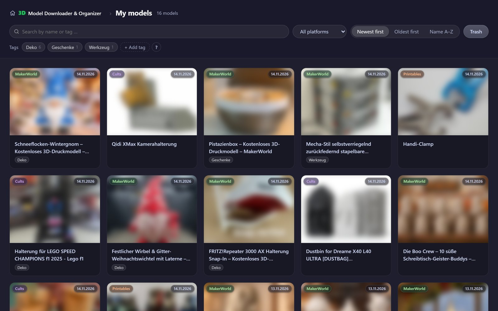

# 3D Model Downloader & Organizer

A Chrome extension for people who download a lot of 3D models. It puts every model from Printables, MakerWorld, Thingiverse and Cults3D into its own tidy folder, gives you a library to find them again – with your own tags – and shows STL, 3MF and STEP files in 3D right in the browser.

**[Get it from the Chrome Web Store](https://chromewebstore.google.com/detail/jddfnhpbcjboomcdjofjcechecpbcplb)** · [Releases](https://github.com/RicardoHipp/3D-Model-Auto-Downloader/releases) · [Deutsch ↓](#deutsch)

## Features

**Downloads that sort themselves**

- Click "Download" on Printables, MakerWorld, Thingiverse or Cults3D – the model lands in its own folder, named after the model, platform and date
- ZIP archives are unpacked, the preview image is saved next to the files, together with the link to the model page and the creator's description
- No save-as dialog for every single file, nothing piling up in your Downloads folder

**Your collection, under control**

- All models as tiles with preview, platform and date; search, filter by platform, sort by date or name
- Your own tags like "garden", "gift" or "already printed" – drag one from the tag bar onto a model, add it with a right-click, or tag several selected models at once
- Filter by tags: pick several and only the models that have all of them remain
- Tags are stored in the model folder, so they survive moving your folders, putting them on a NAS or reinstalling the extension
- A trash with restore instead of permanent deletion – for several models at once, too
- "Open in Explorer" jumps straight to the model's folder

**3D preview right in the browser**

- Rotate, zoom and inspect STL and 3MF without opening a slicer
- Multi-colour 3MF in their actual filament colours
- STEP files from CAD software, with adjustable detail, computed on all cores of your machine
- PDF instructions and images alongside, the creator's description on top

**Split and convert**

- Save STEP and 3MF as STL with one click – centred and placed on Z=0, ready for your slicer
- Break full build plates and assemblies down into their individual parts; show or hide each part and save it as its own STL
- Works with 3MF, STEP assemblies and even plain STL – the extension works out which bodies belong together

**Private and local**

Everything happens on your computer. No accounts, no cloud, no tracking – your files go nowhere except the folder you choose. See the [privacy policy](privacy.html).

## Installation

**From the Chrome Web Store** – [one click](https://chromewebstore.google.com/detail/jddfnhpbcjboomcdjofjcechecpbcplb), updates arrive automatically.

**By hand**

1. Download `extension_<version>.zip` from the [latest release](https://github.com/RicardoHipp/3D-Model-Auto-Downloader/releases/latest) and unpack it into a folder of its own.
2. Open `chrome://extensions` in Chrome.
3. Switch on **Developer mode** at the top right.
4. Click **Load unpacked** and choose the unpacked folder.

An extension loaded this way does not update itself.

On first start the extension asks for a target folder. Chrome does not let extensions write anywhere on disk on their own; once you grant a folder, models go straight into it.

## For developers

- Plain JavaScript, HTML and CSS, Manifest V3 – no build step for the extension itself.
- `pack_extension.bat` packs `extension.zip` with 7-Zip.
- STEP support uses [occt-import-js](https://github.com/kovacsv/occt-import-js) with [Open CASCADE Technology](https://dev.opencascade.org), compiled to WebAssembly with a few changes (progress reporting, re-meshing without re-reading, repair of broken circle edges). Source changes and build scripts are in [`vendor/occt-import-js-quelle`](vendor/occt-import-js-quelle).
- Changes per version: [CHANGELOG.md](CHANGELOG.md) (German).

## Licence

The extension's own code is under the [MIT licence](LICENSE). It ships with third-party libraries under their own licences – JSZip (MIT), occt-import-js and Open CASCADE (LGPL 2.1), Emscripten runtime and musl (MIT). Full texts are in [LIZENZEN-DRITTER.txt](LIZENZEN-DRITTER.txt) and in `vendor/`.

---

# Deutsch

Eine Chrome-Erweiterung für alle, die viele 3D-Modelle herunterladen. Sie legt jedes Modell von Printables, MakerWorld, Thingiverse und Cults3D in einen eigenen, ordentlich benannten Ordner, bietet eine Übersicht zum Wiederfinden – mit eigenen Tags – und zeigt STL, 3MF und STEP direkt im Browser in 3D.

**[Im Chrome Web Store](https://chromewebstore.google.com/detail/jddfnhpbcjboomcdjofjcechecpbcplb)** · [Releases](https://github.com/RicardoHipp/3D-Model-Auto-Downloader/releases)

## Funktionen

**Downloads, die sich selbst sortieren**

- Ein Klick auf „Herunterladen“ bei Printables, MakerWorld, Thingiverse oder Cults3D – und das Modell landet in seinem eigenen Ordner, benannt nach Modell, Plattform und Datum
- ZIP-Archive werden entpackt, das Vorschaubild liegt daneben, dazu der Link zur Modellseite und die Beschreibung des Erstellers
- Kein Speichern-unter-Dialog für jede einzelne Datei, kein Durcheinander im Downloads-Ordner

**Deine Sammlung im Griff**

- Alle Modelle als Kacheln mit Vorschaubild, Plattform und Datum; suchen, nach Plattform filtern, nach Datum oder Name sortieren
- Eigene Tags wie „Garten“, „Geschenk“ oder „schon gedruckt“ – aus der Leiste auf ein Modell ziehen, per Rechtsklick vergeben oder gleich mehreren markierten Modellen auf einmal
- Nach Tags filtern: mehrere ausgewählt, und es bleiben nur die Modelle, die alle davon haben
- Die Tags liegen im Modellordner – sie gehen mit, wenn du die Ordner verschiebst, aufs NAS legst oder die Erweiterung neu installierst
- Papierkorb mit Wiederherstellen statt endgültig löschen – auch für mehrere Modelle auf einmal
- „Im Explorer öffnen“ springt direkt in den Ordner des Modells

**3D-Vorschau direkt im Browser**

- STL und 3MF drehen, zoomen und ansehen, ohne Slicer zu öffnen
- Mehrfarbige 3MF in ihren echten Filamentfarben
- STEP-Dateien aus CAD-Programmen, mit einstellbarer Feinheit, gerechnet auf allen Kernen deines Rechners
- PDF-Anleitungen und Bilder gleich daneben, die Beschreibung des Erstellers obendrauf

**Zerlegen und umwandeln**

- STEP und 3MF mit einem Klick als STL speichern – mittig ausgerichtet und auf Z=0 abgelegt, bereit für den Slicer
- Volle Druckplatten und Baugruppen in ihre Einzelteile zerlegen; jedes Teil ein- und ausblenden und als eigene STL speichern
- Funktioniert mit 3MF, STEP-Baugruppen und sogar mit STL – die Erweiterung erkennt selbst, welche Körper zusammengehören

**Privat und lokal**

Alles passiert auf deinem Rechner. Keine Konten, keine Cloud, kein Tracking – deine Dateien gehen nirgendwohin außer in den Ordner, den du selbst auswählst. Siehe [Datenschutzerklärung](privacy.html).

## Installation

**Aus dem Chrome Web Store** – [mit einem Klick](https://chromewebstore.google.com/detail/jddfnhpbcjboomcdjofjcechecpbcplb), Updates kommen von selbst.

**Von Hand**

1. `extension_<Version>.zip` aus dem [neuesten Release](https://github.com/RicardoHipp/3D-Model-Auto-Downloader/releases/latest) herunterladen und in einen eigenen Ordner entpacken.
2. In Chrome `chrome://extensions` öffnen.
3. Oben rechts den **Entwicklermodus** einschalten.
4. **Entpackte Erweiterung laden** und den entpackten Ordner wählen.

Eine so geladene Erweiterung aktualisiert sich nicht von selbst.

Beim ersten Start fragt die Erweiterung nach einem Zielordner. Chrome lässt Erweiterungen nicht von selbst auf die Festplatte schreiben; ist ein Ordner einmal freigegeben, landen die Modelle direkt darin.

## Für Entwickler

- Reines JavaScript, HTML und CSS, Manifest V3 – die Erweiterung selbst braucht keinen Build-Schritt.
- `pack_extension.bat` packt `extension.zip` mit 7-Zip.
- Die STEP-Unterstützung nutzt [occt-import-js](https://github.com/kovacsv/occt-import-js) mit [Open CASCADE Technology](https://dev.opencascade.org), nach WebAssembly übersetzt mit einigen Änderungen (Fortschrittsanzeige, neu zerlegen ohne neu einzulesen, Reparatur fehlerhafter Kreiskanten). Änderungen und Bauskripte liegen in [`vendor/occt-import-js-quelle`](vendor/occt-import-js-quelle).
- Änderungen je Version: [CHANGELOG.md](CHANGELOG.md).

## Lizenz

Der eigene Code der Erweiterung steht unter der [MIT-Lizenz](LICENSE). Mitgeliefert werden Bibliotheken Dritter unter ihren eigenen Lizenzen – JSZip (MIT), occt-import-js und Open CASCADE (LGPL 2.1), Emscripten-Laufzeit und musl (MIT). Die vollständigen Texte stehen in [LIZENZEN-DRITTER.txt](LIZENZEN-DRITTER.txt) und in `vendor/`.
